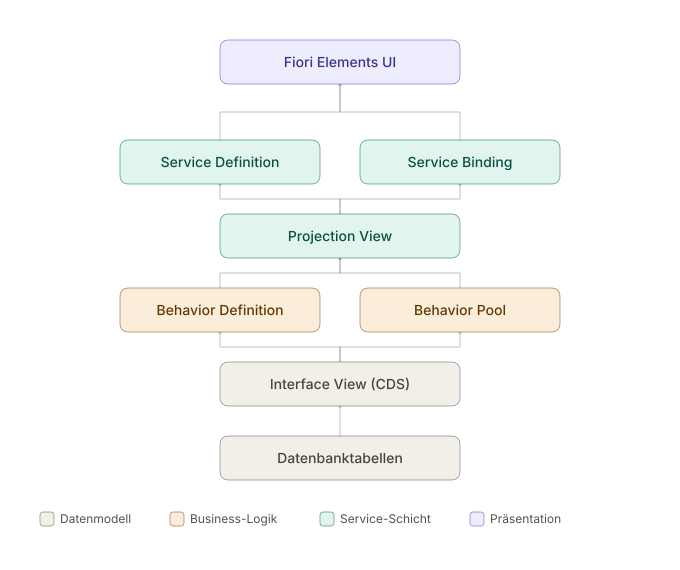
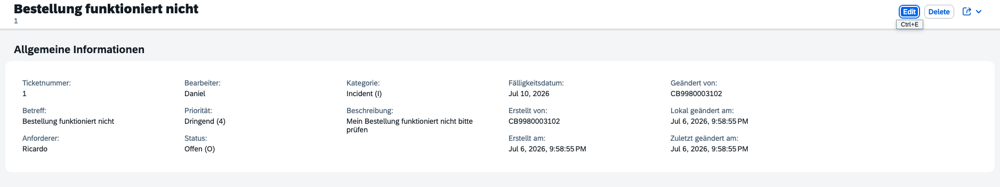
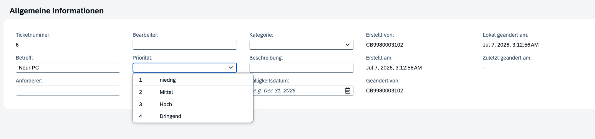
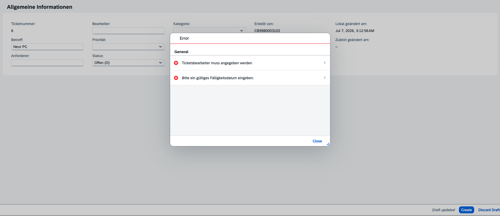
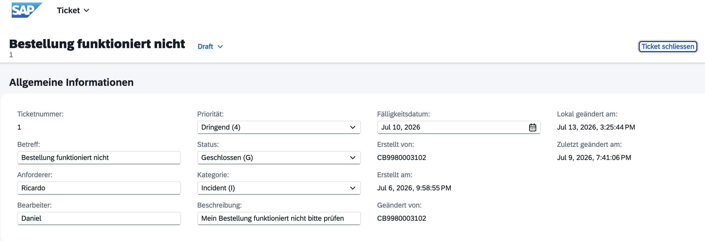

# NovaDesk

NovaDesk ist eine moderne Helpdesk-Anwendung für IT-Support- und Change-Request-Prozesse, entwickelt mit dem SAP RESTful Application Programming Model (RAP) auf der SAP Business Technology Platform.

## Funktionsumfang

- Vollständiges Ticket-Lifecycle-Management mit Draft-Handling (Anlegen, Bearbeiten, Aktivieren, Verwerfen)
- Automatische, schreibgeschützte Ticketnummer ab dem ersten Entwurf
- Initialstatus „Offen“ und zustandsabhängige Aktion „Ticket schließen“
- Serverseitige Validierung von Pflichtfeldern und Geschäftsregeln
- Kategorisierung nach Typ (Incident, Change Request, Hardware, Software, Access Request)
- Priorisierung (Niedrig bis Dringend)
- Volltextsuche über zentrale Ticketfelder
- Wertehilfen mit Klartext-Anzeige für Status, Priorität und Kategorie

## Architektur

```text
Datenbanktabelle
      ↓
Interface View (CDS)
      ↓
Behavior Definition ←→ Behavior Pool (ABAP-Klasse)
      ↓
Projection View
      ↓
Service Definition → Service Binding (OData V4)
      ↓
Fiori Elements UI
```

Das Datenmodell folgt konsequent der RAP-Schichtentrennung: Die Root-Ebene bildet ausschliesslich physische Tabellenfelder und Assoziationen ab; sämtliche UI-spezifische Logik (Textauflösung, Wertehilfen, Feldbeschriftungen) ist in der Projection-Ebene und den Metadata Extensions gekapselt.



Die aktive Kette in `NOVADESK_DEV` verwendet die Tabelle `ZTICKET_ITEM_03`, den RAP-Root `ZR_TICKET_ITEM_03000` mit Behavior-Pool `ZBP_R_TICKET_ITEM_03`, die Projektion `ZC_TICKET_ITEM_03` und das veröffentlichte OData-V4-UI-Binding `ZUI_TICKET_ITEM_03_O4`. Die Oberfläche läuft in der SAP Fiori Elements App Preview.
## Projektstruktur

Der [SAP-Snapshot](sap_snapshots/NOVADESK_DEV_ZZ1_NOVADESK_PHASE_A/) enthält die gesicherten Quellen der aktiven Kette einschließlich Nummernkreisobjekt und Einrichtungs-Klasse. Die nachfolgend aufgeführten Verzeichnisse im Repository-Stamm dokumentieren frühere Entwicklungsstände.

```text
01_database_tables/         Persistenz- und Referenztabellen
03_interface_views/         Root CDS View Entities
04_projection_views/        Consumption Views mit UI-Annotationen
05_behavior_definitions/    RAP Behavior Definitions (Root & Projection)
06_behavior_implementations/ ABAP-Klassen: Determinations, Validations, Numbering
07_value_helps/             Value-Help-Entities für Status, Priorität, Kategorie
08_service_definitions/     OData-V4-Service-Definitionen
09_metadata_extensions/     UI-Facetten, Feldpositionierung, Objekttitel
notes/                      Technische Notizen zu Implementierungsdetails
```

## Technologie-Stack

| Bereich | Technologie |
|---|---|
| Backend | ABAP Cloud, RAP (Managed Implementation) |
| Datenmodell | CDS View Entities, Behavior Definitions |
| Persistenz | SAP HANA (BTP ABAP Environment) |
| Frontend | SAP Fiori Elements |
| Protokoll | OData V4 |
| Entwicklungsumgebung | ABAP Development Tools (ADT) für Eclipse und VS Code |

## Datenmodell

**Ticket** (Root-Entity)

| Feld | Beschreibung |
|---|---|
| TicketID | Automatisch vergebener, schreibgeschützter Schlüssel vom Typ `NUMC(8)` |
| Subject | Betreff, dient als Objekttitel in der UI |
| RequesterID | Anforderer des Tickets |
| AssignedTo | Zuständiger Bearbeiter (Pflichtfeld) |
| Priority | Niedrig / Mittel / Hoch / Dringend |
| Status | Offen / In Bearbeitung / Geschlossen / Gelöst |
| Category | Incident / Change Request / Hardware / Software / Access Request |
| DueDate | Fälligkeitsdatum (darf nicht in der Vergangenheit liegen) |

## Geschäftslogik

- **Determination:** Beim Anlegen wird der Status automatisch auf *Offen* gesetzt.
- **Validation – Bearbeiter:** Ein Ticket kann nicht gespeichert werden, ohne dass ein Bearbeiter zugewiesen ist.
- **Validation – Fälligkeitsdatum:** Das Fälligkeitsdatum muss heute oder später liegen.
- **Early Numbering** vergibt die TicketID bereits beim Anlegen des Entwurfs über den internen SAP-Nummernkreis `ZNOVATKT/01` (`10000–99999`, kein automatischer Wiederanlauf). RAP prüft die reservierte Nummer gegen aktive Tickets und Entwürfe des veröffentlichten BOs. Beim Speichern bleibt die Nummer erhalten. Die Pufferung kann zu Lücken führen.
- **Ticket schließen** ist für aktive Tickets mit Status Offen, In Bearbeitung oder Gelöst verfügbar, sofern kein Bearbeitungsentwurf vorhanden ist. Instance Feature Control steuert die Verfügbarkeit in Fiori. Der Action-Handler prüft dieselben Bedingungen serverseitig.

## Fiori-Vorschau und Teststand

Die Liste zeigt Ticketnummer, Betreff, Status, Priorität, Bearbeiter, Kategorie und Fälligkeit. Die sechs Standardfilter sind Ticketnummer, Status, Priorität, Bearbeiter, Kategorie und Fälligkeit. Die Objektseite gliedert sich in **Ticketdaten**, **Zuständigkeit**, **Beschreibung** und **Technische Informationen**.

Mit `sap-ui-language=DE` verwendet die Vorschau deutsche SAP-Standardaktionen und Datumsformate. Kategoriebezeichnungen wie „Change Request“ stammen aus den Referenzdaten. Neue Ticketnummern erscheinen fünfstellig. Bestehende Nummern wie `20` und `3030` behalten ihre bisherige Anzeige.

In Mandant 100 wurden Liste, Suche, Filter, Wertehilfen und der Ticket-Lifecycle in Fiori geprüft. Zwei gleichzeitig offene Entwürfe derselben SAP-Anmeldung erhielten automatisch `10000` und `10010`. Ein Lauf mit zwei getrennten SAP-Benutzern und ein Test bei erschöpftem Nummernkreis stehen aus. Das Intervall wird pro Mandant eingerichtet. Ergebnisse und Einrichtungshinweise stehen im [Fiori-Testprotokoll](FIORI_TEST_RESULTS.md).

## Nächste Ausbauschritte

⬜ Attachments

⬜ Email Integration

⬜ Notification Handling

⬜ Ticketverlauf

## Screenshots

Die Screenshots zeigen frühere Stände der Vorschau.

### Ticketübersicht
Alle Tickets mit Klartext-Anzeige für Priorität, Status und Kategorie, mit Filterleiste.


### Ticket-Detailansicht
Einzelansicht mit Ticketnummer und Ticketdaten.



### Wertehilfe mit Klartext-Anzeige
F4-Wertehilfe mit Code- und Textanzeige, z. B. für das Statusfeld.



### Validierung bei fehlenden Pflichtfeldern
Serverseitige Validierung verhindert das Speichern, solange Pflichtfelder nicht ausgefüllt sind.



### Aktion „Ticket schließen“
Die Aktion setzt den Status eines zulässigen Tickets auf „Geschlossen“.



### Ticketbeschreibung

Das Anliegen kann im Abschnitt „Beschreibung“ mehrzeilig erfasst werden.


## Autor

Ricardo Varesse Noubissi Simo
SAP Solution Consultant Technology 
SAP Certified ABAP Cloud & CPI Integration Developer

[LinkedIn](https://www.linkedin.com/in/ricardo-varesse-noubissi-simo-340319172/)
