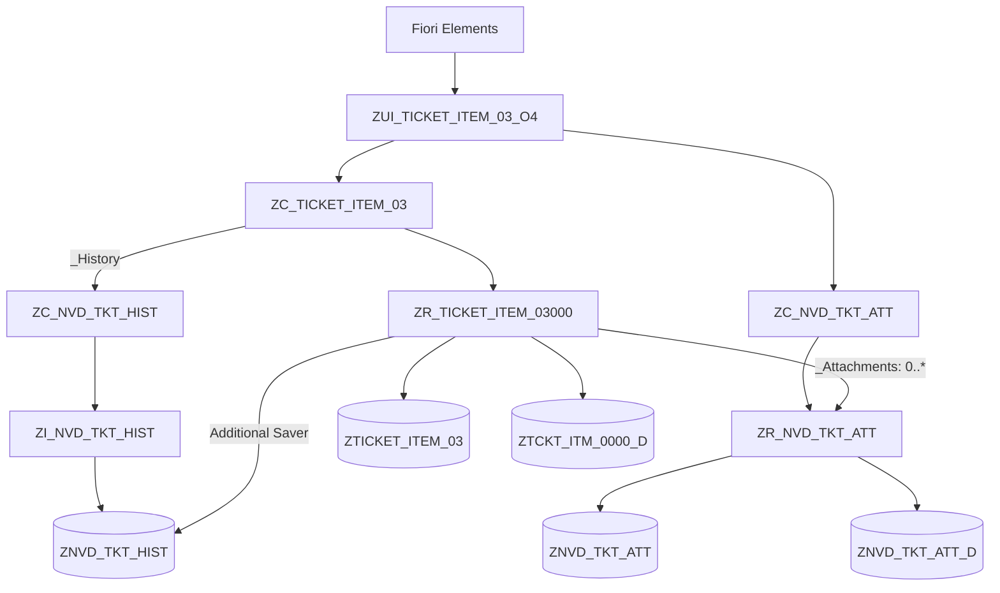
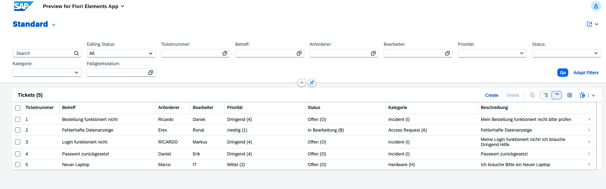
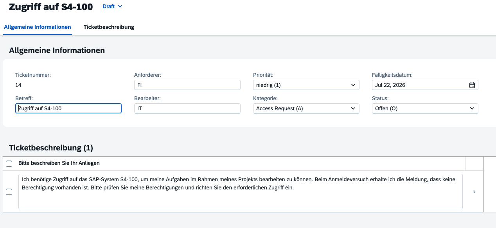

# NovaDesk

NovaDesk ist ein Ticket-System auf SAP BTP ABAP Environment. Die Anwendung nutzt ABAP Cloud, RAP Managed mit Draft, CDS und Fiori Elements für OData V4. In der Ticketliste stehen sechs Fachfilter für Ticketnummer, Status, Priorität, Bearbeiter, Kategorie und Fälligkeit sowie die Draft-Filterung zur Verfügung. Wertehilfen liefern Klartext für Status, Priorität und Kategorie.

## Ticket-Workflow

| Ausgangsstatus | Fiori-Aktion | RAP-Aktion | Zielstatus |
| --- | --- | --- | --- |
| Offen (O) | Bearbeitung starten | `startWork` | In Bearbeitung (B) |
| In Bearbeitung (B) | Als gelöst markieren | `markResolved` | Gelöst (L) |
| Gelöst (L) | Wieder öffnen | `reopenTicket` | In Bearbeitung (B) |
| Gelöst (L) | Ticket schließen | `closeTicket` | Geschlossen (G) |
| Geschlossen (G) | Keine Statusaktion | | Endzustand |

Neue Tickets beginnen mit `O`. Der Status ist schreibgeschützt und ändert sich über RAP-Aktionen. Instance Feature Control und die Action-Handler prüfen den Ausgangsstatus und sperren Aktionen für Draft-Instanzen und aktive Tickets mit Bearbeitungsentwurf. Leere und unbekannte Statuswerte erlauben keinen Übergang. Der Ticket-DELETE bleibt in Root und Projektion exponiert.

## Anhänge

Die Objektseite zeigt Anhänge über `_Attachments` mit Dateiname, Dateityp, Erstellungsdatum und Ersteller. Upload, Download und Löschen nutzen Fiori-Elements-Standardfunktionen. Der OData-V4-Dateiinhalt ist ein `Edm.Stream`.

- PDF, PNG und JPEG sind zulässig. RAP prüft bei der Aktivierung die Vollständigkeit von Dateiname, MIME-Typ und Inhalt, die Dateisignatur und das Limit von 10 MiB je Datei.
- Leere Anhangszeilen sind während der Draft-Bearbeitung möglich. Dauerhaft gespeichert werden vollständige, gültige Anhänge.
- Bei geschlossenen Tickets sperren Instance Feature Control, Prechecks und die zusätzliche Draft-Aktivierungsprüfung Änderungen. Der Download bleibt verfügbar.
- Die Attachment-DCLs übernehmen die Zugriffsbedingungen des Ticket-BOs. Technische Schlüssel bleiben in der Oberfläche ausgeblendet.

## Architektur und Datenmodell

| Daten | Speicherung und Schlüssel |
| --- | --- |
| Ticket | `ZTICKET_ITEM_03` mit mandantenabhängigem `TicketID` als `NUMC(8)`. Enthält Betreff, Status, Priorität, Kategorie, Zuständigkeit, Beschreibung, Fälligkeit und Auditfelder. |
| Ticketentwurf | `ZTCKT_ITM_0000_D`. Die alte Draft-Tabelle `ZTCKET_ITEM_03_D` existiert weiterhin. |
| Anhang | `ZNVD_TKT_ATT` mit verwalteter RAW(16)-UUID, Ticketreferenz, Dateiname, MIME-Typ, Binärinhalt und Auditfeldern. |
| Anhangsentwurf | `ZNVD_TKT_ATT_D`. Der Anhang hat einen lokalen ETag. Sperren und Änderungsberechtigungen sind vom Ticket abhängig. |
| Ticketverlauf | `ZNVD_TKT_HIST` mit Ereignis-UUID, gemeinsamer Änderungs-UUID je Speichervorgang, Ticketnummer, optionaler Attachment-UUID, Ereignistyp, Feld, Alt- und Neuwert, Benutzer und Zeitstempel. |
| Referenzdaten | `ZTICKET_CAT_03`, `ZTICKET_PRIO_03` und `ZTICKET_STATUS` versorgen die Wertehilfen. |

RAP Early Numbering reserviert Ticketnummern aus `ZNOVATKT/01` im Bereich 10000–99999. Die Nummer steht beim Anlegen des Entwurfs fest und bleibt schreibgeschützt. SAP speichert sie im bestehenden achtstelligen Schlüssel. Nummernlücken sind durch Pufferung möglich. Das Intervall muss im jeweiligen Zielmandanten eingerichtet werden. Beim Speichern prüft RAP außerdem den Bearbeiter und die Fälligkeit.

### Ticketverlauf

Der Additional Saver in `ZBP_R_TICKET_ITEM_03` schreibt den Verlauf in derselben RAP-Transaktion wie Ticket und Anhänge. Vor der Speicherung erfasst RAP die aktiven Vorwerte. Beim Speichern entstehen Ereignisse für Ticketanlage, Ticketlöschung, Änderungen protokollierter Felder, Workflow-Übergänge sowie hinzugefügte, geänderte, ersetzte und gelöschte Anhänge. Der Saver vergleicht den Dateiinhalt nur im Speicher und erkennt dadurch auch einen Austausch bei identischem Dateinamen. Binärdaten und die Alt- und Neuwerte der Ticketbeschreibung werden in der Historie nicht abgelegt. Unverändertes Speichern und verworfene Entwürfe erzeugen keine zusätzlichen Einträge.

`ZI_NVD_TKT_HIST` verknüpft den Verlauf beim Lesen mit dem aktiven Ticket. Beide History-Entitäten übernehmen per DCL die Leseregel des Ticket-BOs. Die gegenwärtige Ticket-DCL enthält innerhalb des berechtigten Servicezugriffs keine Einschränkung je Ticket. Nach einer Ticketlöschung bleiben die Ereignisse physisch erhalten. Die lesende OData-Navigation `_History` und das direkt exponierte History-Entity-Set geben sie dann nicht mehr aus. Die Fiori-Objektseite zeigt Ereignis, Feldname, Altwert, Neuwert, Benutzer und Zeitstempel in absteigender Zeitfolge. Technische UUIDs sind in Fiori ausgeblendet. Die Ereignis-UUID bleibt der technische OData-Schlüssel.

## Freigabeabhängigkeit des Beitragsmoduls

Die Backend-Kompositionen für Kommentare und interne Notizen sind in `NOVADESK_DEV` vorbereitet. Die aktiven und Draft-Lesesichten sperren den Zugriff per DCL. RAP lehnt Schreibzugriffe ab und prüft beim Aktivieren erneut. Der veröffentlichte Ticketservice enthält keine Beitragsentitäten.

Die Supportteam- und Mitgliedschaftstabellen `ZNVD_TEAM` und `ZNVD_TEAM_MEMBER`, die technischen Zuordnungsfelder in Ticket und Draft sowie der lesende Migrationsprüflauf `ZCL_NVD_MIGRATION_CHECK` sind aktiv. **Das Berechtigungsmodul ist unvollständig.** Die Migrationsklassifikation ist mit ABAP Unit abgedeckt. In Eclipse wurden das Authorization Object `ZNVD_TKT` und der Business Catalog `ZNVD_TICKET_BC` angelegt. Die fachlichen Authorization Objects sind im SAP-Repository angelegt. Das Team-Berechtigungsfeld `ZNVD_TEAM` ist aktiv und in `ZNVD_TKT` und `ZNVD_AGT` hinterlegt. Fachliche IAM-Konfiguration, Ticketautorisierung, Aktivierung der Bestandssperre und bestätigte Bestandszuordnungen stehen aus. [Berechtigungskonzept und Trial-Status](docs/AUTHORIZATION_CONCEPT.md)

Vor Veröffentlichung muss das Rollenmodul Ticket-Sichtbarkeit, getrennte Beitragsschreibrechte und ein separates Leserecht für interne Notizen liefern. Die Einbindung muss Änderungen an gespeicherten Beiträgen weiterhin sperren und Rechteentzug bei offenen Entwürfen berücksichtigen. Die Freigabetests brauchen getrennte Testidentitäten für direkte Zugriffe, Navigation, Drafts und die Trennung von öffentlicher Historie und internem Audit. Positive Save-Tests für Autor, UTC-Zeitstempel und Audit-Erzeugung folgen mit der Rollenfreigabe.

## Projektstruktur

| Pfad | Zweck |
| --- | --- |
| [sap_snapshots/ACTIVE](sap_snapshots/ACTIVE/) | Aktiver SAP-Quellstand, mit SHA-256-Manifest |
| [sap_snapshots](sap_snapshots/) | Übersicht und Kennzeichnung der historischen Snapshots. Das alte CDS und Behavior `ZR_TICKET_ITEM_03` sind nur historisch enthalten. |
| Nummerierte Quellordner `01_…` bis `09_…` | Historische Entwicklungsdateien |
| [11_screenshots](11_screenshots/) | Historische Fiori-Ansichten |
| [FIORI_TEST_RESULTS.md](FIORI_TEST_RESULTS.md) | Nachweise und offene Laufzeittests |

## Teststand und Roadmap

Die Fiori-Vorschau wurde für PDF-Upload und bytegleichen Download, PNG- und JPEG-Speicherung, Anhangslöschung, Draft-Validierung und die Anhangssperre an einem geschlossenen Ticket geprüft. Einzelne Testlücken sind im Testbericht ausgewiesen.

Die Abschlussabnahme des Ticketverlaufs bestätigte in Fiori alle vier Anhangsereignisse und die Draft-Regression mit regulärem `Activate`. Nach der Ticketlöschung blieben sechs Historienzeilen in der Tabelle erhalten, während OData keine Verlaufsdaten mehr lieferte. Alle fünf bestehenden ABAP-Tests und ein gezielter Rollback-Test vor dem Speichern bestanden. Offen sind die Prüfung mit zweiter Berechtigungsidentität, ein erzwungener Fehler im späten RAP-Save und mehrere Workflow-Aktionen innerhalb einer LUW. [Abnahme und Backlog](FIORI_TEST_RESULTS.md#abschlussabnahme-ticketverlauf-am-24-november-2026)

Offene Ausbauschritte sind das rollenbasierte Berechtigungskonzept für Ticket-DELETE, direkte OData-Negativtests für geschlossene Tickets, ein belastbarer Test der Workflow-Sperre bei fremdem Bearbeitungsentwurf und die Laufzeitprüfung der SAP-Virenerkennung für den NovaDesk-Stream. Die MIME-Spalte bleibt bei offenen Tickets im Bearbeitungsmodus editierbar, damit der Standard-Upload den Typ setzen kann.

### Langfristige Roadmap

- **Customer-owned infrastructure first.** Kundeneigene Infrastruktur ist das bevorzugte Ziel für Betrieb und Kontrolle über NovaDesk.
- **Kundeneigene SAP-Systeme.** Die Machbarkeit je Zielsystem anhand von Release, ABAP-Cloud- und RAP-Funktionen, IAM und Betriebsaufwand prüfen.
- **Alternative Betriebsmodelle.** SAP Cloud und eine eigene Cloud-Infrastruktur als separate Betriebsmodelle evaluieren. SAP-Laufzeit, Schnittstellen und Verantwortlichkeiten je Variante festhalten.
- **Nachweisbare Datenspeicherung und Deployment-Architektur.** Speicherorte, Datenflüsse, Zugriff, Aufbewahrung, Löschung, Backups und Wiederherstellung dokumentieren. Datenschutz und die Deployment-Architektur je Betriebsmodell verifizieren.
- **Öffentliche Produktwebsite.** Erst umsetzen, wenn mindestens 95 % der definierten Produktziele mit dokumentierten Abnahmen nachgewiesen sind.

## Screenshots

Die Screenshots zeigen frühere Stände der Vorschau.

### Ticketübersicht
Alle Tickets mit Klartext-Anzeige für Priorität, Status und Kategorie, mit Filterleiste.

### Ticket-Detailansicht
Einzelansicht mit Ticketnummer und Ticketdaten.

### Wertehilfe mit Klartext-Anzeige
F4-Wertehilfe mit Code- und Textanzeige, z. B. für das Statusfeld.

### Validierung bei fehlenden Pflichtfeldern
Serverseitige Validierung verhindert das Speichern, solange Pflichtfelder nicht ausgefüllt sind.

### Aktion „Ticket schließen“
Die Aktion setzt den Status eines zulässigen Tickets auf „Geschlossen“.

### Ticketbeschreibung

Das Anliegen kann im Abschnitt „Beschreibung“ mehrzeilig erfasst werden.

## Autor

Ricardo Varesse Noubissi Simo
SAP Solution Consultant Technology 
SAP Certified ABAP Cloud & CPI Integration Developer

[LinkedIn](https://www.linkedin.com/in/ricardo-varesse-noubissi-simo-340319172/)
